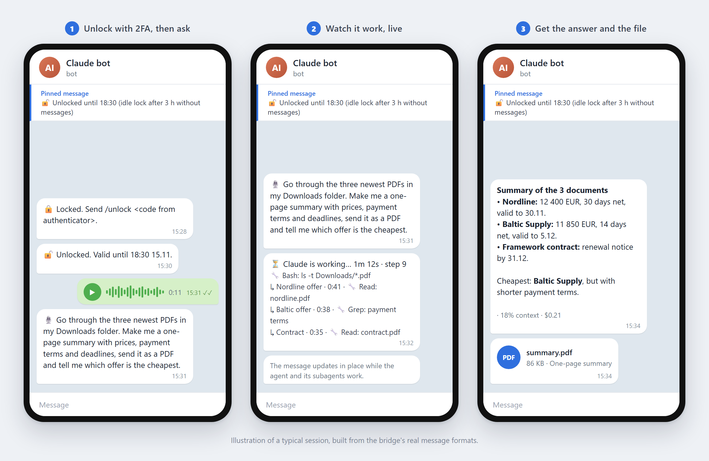
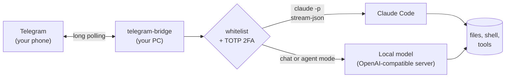

# AI-TelegramBridge

[](https://github.com/jan-osicka/AI-TelegramBridge/actions/workflows/ci.yml)


[](LICENSE)

**Send a message from your phone, and the AI agent on your own computer does the work and sends you the result.**

You write to a Telegram bot. The bridge passes the task to [Claude Code](https://claude.com/claude-code) running on your PC, shows what it is doing while it works, and sends back the answer and any files it made. A second bot can drive a local model the same way, for free and offline. Text, photos, files, voice messages and videos all work.

Nothing is hosted in the cloud. There is no port to open and no public IP. Only your Telegram account gets in, and only after a 2FA code.



## What it can do

- Run any task on your PC from your phone: code, files, research, scripts, system admin.
- Show live progress while the agent works: the current tool, steps, subagents, elapsed time.
- Take photos, documents, voice messages (transcribed locally with Whisper) and videos (frames plus transcript).
- Send files back. The agent adds a `[tg-file]` line to its answer and the bridge uploads the file.
- Keep context between messages, show how full the context is, and survive restarts.
- Drive a local model as a second bot, with a fast chat mode for quick questions.
- `notify` command so any script or scheduled job can message you.
- `doctor` command that checks the whole installation without changing anything.
- Autostart on Windows, Linux and macOS.

## How it works



The bridge is one Python process that polls Telegram for both bots. For each task it starts the agent CLI in headless mode, reads its stream-json output line by line, and turns the events into a progress message that it edits in place. When the task ends it sends the final answer, formatted for Telegram and split safely, plus any files.

Some design decisions that matter in daily use:

- **Prompt cache aware sessions.** Each reply resumes the same Claude Code session, so the agent keeps its context. A large session that sat idle for over an hour starts fresh, because the prompt cache has expired by then and resuming would re-read the whole context at full price. `/back` returns to the old session if you need it.
- **Context meter.** Every answer ends with how full the context window is, with warnings at 70% and 90%, so you know when to start a new session.
- **Live subagent view.** When Claude Code delegates work to subagents, the progress message shows each one and what it did last.
- **Restart without losing work.** The running task and the queue are written to a journal. After a crash or reboot the bridge tells you what was cut off and waits for `/resume` or `/drop`. It never repeats a task on its own.
- **Local model on demand.** The second bot starts the model server when a task arrives and stops it after 20 minutes idle, so the VRAM is free the rest of the time. Short questions go straight to the chat API and get an answer in a second or two. Tasks that need tools go through the full agent loop.
- **Secrets never leave by accident.** Every reply, notification and log line is scanned and API keys or tokens are masked. The scan runs before the text is split into Telegram messages, so a secret can't slip through cut in half.
- **Outgoing files are checked after the path is resolved,** so `..`, symlinks and junctions can't get around the outbox rules.

## How it was built

I built this with Claude Code as a test of how far careful agent work can go on a real tool I use every day.

The bigger changes started as a written spec with goals, non-goals and "anti-goals" (things that count as failure even if the code works, like a safeguard that exists but is never called). Then came an implementation plan split into tasks. Claude Code worked through the tasks with subagents, each change was reviewed against the spec, and the whole branch got a final review before it went live. Tests were written alongside the code: there are now 365, and CI runs them on Windows, Linux and macOS on every push.

A test also checks that no personal data (names, paths, persona prompts) ends up in the repository. Everything personal lives in the user's own config folder.

## Quick start

You need Python 3.12, [uv](https://docs.astral.sh/uv/), Claude Code installed and logged in (a Claude subscription or an API key), a Telegram account and an authenticator app. Windows is used every day, Linux and macOS are tested in CI. Voice and the local model are optional, see [USAGE.md](USAGE.md#requirements-in-detail).

```bash
git clone https://github.com/jan-osicka/AI-TelegramBridge
cd AI-TelegramBridge
uv sync --extra qr             # add --extra voice for voice messages, --extra cuda on an NVIDIA GPU
uv run telegram-bridge setup
```

Install uv with `powershell -ExecutionPolicy ByPass -c "irm https://astral.sh/uv/install.ps1 | iex"` on Windows or `curl -LsSf https://astral.sh/uv/install.sh | sh` on Linux and macOS. Voice also needs ffmpeg (`winget install ffmpeg`, `apt install ffmpeg`, `brew install ffmpeg`).

### Setup step by step

1. Open Telegram, talk to [@BotFather](https://t.me/BotFather), send `/newbot` and copy the token.
2. Run `uv run telegram-bridge setup`. It creates the home folder `~/.telegram-bridge` (or the folder in `TELEGRAM_BRIDGE_HOME`) with `inbox`, `outbox` and `logs`, a `.env` template, a TOTP secret, a QR code (`totp-qr.png`) and a copy of the example config as `config.toml`. It also restricts the folder to your user. Add `--whisper` to download the voice model now.
3. Scan `totp-qr.png` with your authenticator app, then delete the file. It contains the secret.
4. Put the bot token into `.env` as `CLAUDE_BOT_TOKEN=...`.
5. Find your numeric Telegram id. While `ALLOWED_USER_IDS` is empty, the bot answers `/whoami`. Start the bridge once (`uv run telegram-bridge run`), send `/whoami` to your bot, then stop it with Ctrl+C.
6. Put the id into `.env` as `ALLOWED_USER_IDS=123456789` (comma separated for more people).
7. Edit `config.toml` in the home folder. The settings to check are `cwd` (where the agent works), `allowed_cwd_roots` (the folders `/cwd` may point to) and `outbox_dirs` (extra folders the agent may send files from). Secrets never go into `config.toml`.
8. Check everything: `uv run telegram-bridge doctor --online`. Fix every FAIL.
9. Start the bridge: `uv run telegram-bridge run`.
10. In Telegram send `/unlock 123456`, with the current code from your authenticator app. Then write a task.

Only one instance can run at a time. A second one exits with a message.

## Run in the background

```
uv run telegram-bridge service print      # show what would be installed
uv run telegram-bridge service install
uv run telegram-bridge service remove
```

- Windows: registers a Task Scheduler task named `TelegramBridge` that starts at logon and restarts on failure. Start it now with `Start-ScheduledTask -TaskName TelegramBridge`.
- Linux: writes `~/.config/systemd/user/telegram-bridge.service` and runs `systemctl --user enable --now telegram-bridge.service`.
- macOS: writes `~/Library/LaunchAgents/com.telegram-bridge.plist` and loads it with `launchctl`.

All three start `telegram-bridge run --service` from the project virtual environment.

## Using it

| Command | What it does |
| --- | --- |
| `/unlock <code>` | Unlock with a 2FA code |
| `/lock` | End the unlocked session |
| `/exit`, `/new` | Clear the context and start a new session |
| `/back` | Return to the session an idle reset replaced |
| `/stop` | Kill the running task. `/stop all` also clears the queue |
| `/resume`, `/drop` | Continue or forget a task a restart interrupted |
| `/status` | Lock state, running task, session |
| `/cwd [path]` | Show or set the working folder |
| `/modelstart`, `/modelstop` | Start or stop the local model server (local-model bot only) |
| `/help` | List the commands |

Anything else is a task for the agent. More detail, including chat mode for a local model, is in [USAGE.md](USAGE.md).

**Sending files back.** The agent puts a line like this in its final reply:

```
[tg-file] /home/me/.telegram-bridge/outbox/report.pdf
[tg-file] "/home/me/.telegram-bridge/outbox/my report.pdf" | caption text
```

The bridge removes the line and uploads the file, at most 10 files and 50 MB each. A file is sent only from `<home>/outbox` or a folder listed in `outbox_dirs`. A refused file is reported in the chat with the reason. Set `outgoing_files = false` in `[general]` to turn this off.

**Notify from scripts.** No running bridge is needed.

```
uv run telegram-bridge notify "Backup finished"
uv run telegram-bridge notify "Report attached" --file /path/to/outbox/report.pdf
echo "long text" | uv run telegram-bridge notify --silent
```

Options: `--bot NAME`, `--file PATH` (repeatable), `--silent`. Exit codes: 0 ok, 2 usage or config error, 4 Telegram or network failure, 5 a file was refused or failed to upload (the text is still sent).

**Pinned status message.** Each bot keeps one pinned message in your private chat. It shows whether the bridge is locked or unlocked, and until when. Set `status_pin = false` in `[general]` to turn it off.

## Security

The agent has full access to the computer. The example config starts Claude Code with `--permission-mode bypassPermissions`, so it never asks before running a command. That is the point of the tool, and it is why the access control is strict:

- Only whitelisted Telegram ids get any answer. Everyone else is ignored and logged.
- Every session starts with a TOTP code, wrong codes lock you out, and sessions expire after a set time and after inactivity.
- Secrets are masked in everything that leaves the bridge.
- The agent can send only files from the outbox.

Read [SECURITY.md](SECURITY.md) before you put a token in `.env`. It also lists what is not protected.

## Troubleshooting

- Run `uv run telegram-bridge doctor` (add `--online` to call Telegram and the local model). It prints OK, WARN or FAIL, is read-only, and its output has no secrets.
- Logs are in `<home>/logs/bridge.log`, which is `~/.telegram-bridge/logs/bridge.log` by default.
- The log line "409 Conflict" means another program is polling the same bot token. Stop the other copy or use a different token.
- Voice does not work: doctor shows whether the `voice` extra, the Whisper model and ffmpeg are present. Install what is missing (`uv sync --extra voice`, ffmpeg) and run `uv run telegram-bridge setup --whisper`.
- "Already running": a live process holds the lock. A lock file left by a crash does not block a start.

## Updating and uninstalling

Update with `git pull`, then `uv sync` with the same extras as before, then restart the service (on Windows: `Stop-ScheduledTask -TaskName TelegramBridge; Start-ScheduledTask -TaskName TelegramBridge`). What changed is in [CHANGELOG.md](CHANGELOG.md).

Uninstall: run `uv run telegram-bridge service remove`, then delete the project folder and `~/.telegram-bridge`. Revoke the bot token in @BotFather if you no longer need it.

## Tests

```
uv sync --extra qr
uv run pytest -q
```

## Credits

The secret-detection patterns and several other ideas come from [Agent2Telegram](https://github.com/petrludwig-collab/Agent2Telegram), MIT licence. See `NOTICE`.

## License

MIT. See `LICENSE`.
